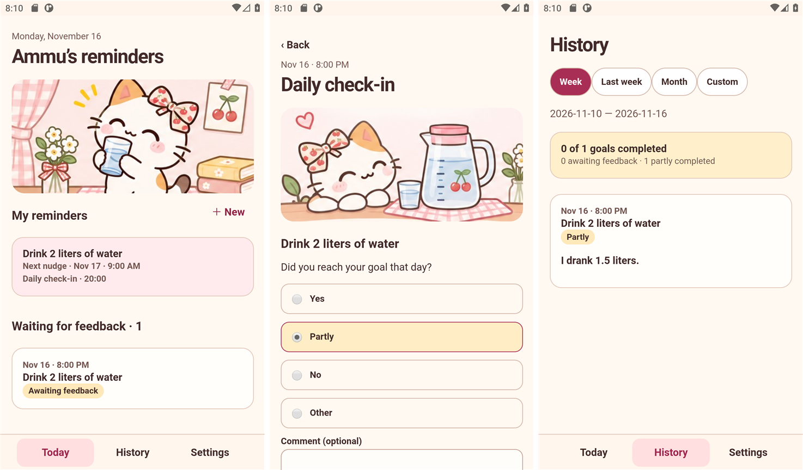

# Ammu Reminders

Ammu Reminders is an offline Android app for recurring goals. For example, the water template sends a nudge every three hours and asks once in the evening how the day went. Email and custom reminders can ask for feedback after each occurrence.

## Using the app

Requires Android 8 or newer. Open Settings in the app to enable notifications and precise alarms. Choose **Today → + New** to set up a goal. History shows results, pending check-ins and comments by date range. Reminder schedules and feedback stay in the app's local SQLite database.

[Illustrated quick guide (PDF)](output/pdf/Ammu-Reminders-Quick-Guide.pdf)

## Build on Windows

Install Python 3, a Windows x64 JDK 17, and Android SDK Platform 35 and Build Tools 35.0.0. From the repository root, arrange the tools as follows (copy the installed directories or use directory junctions):

    .tools/jdk-17/bin/javac.exe
    .tools/build-tools-35/aapt.exe
    .tools/build-tools-35/lib/d8.jar
    .tools/android-35/android.jar

Run `python build.py`. The script creates and verifies `Ammu-Reminders.apk`. On the first build it generates a signing key in `.signing/`. Back up this directory privately to sign future updates with the same key. Each developer's key is unique.

## Run the recurrence checks

With JDK 17 on PATH, run these commands from the repository root:

    javac -d build/rules src/Rule.java tests/RuleCheck.java
    java -cp build/rules app.ammu.reminders.RuleCheck

The checks cover hourly windows, fortnightly schedules, leap years, and month-end recurrence.

## License

[MIT](LICENSE).
